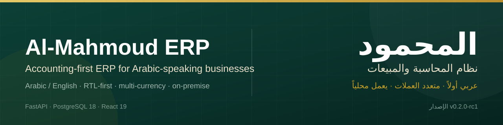
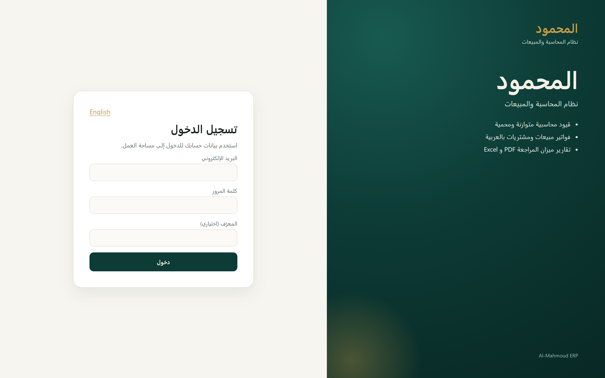
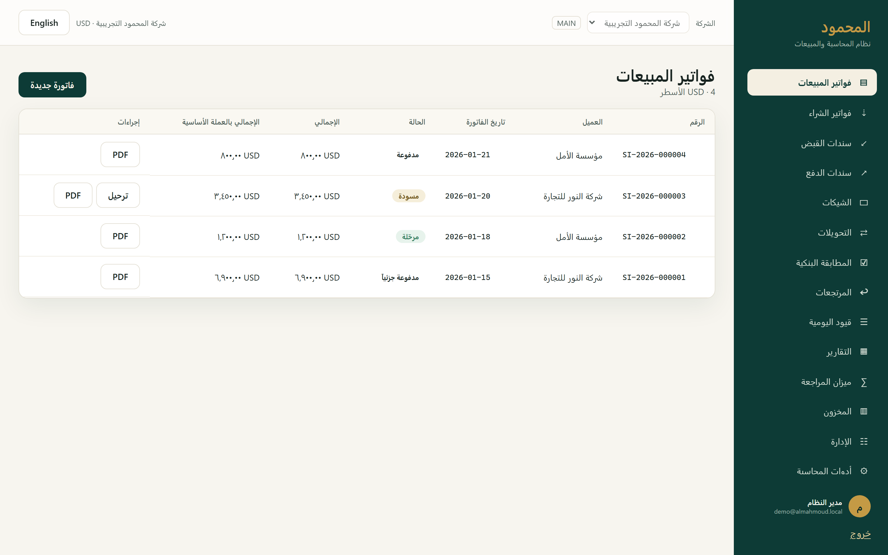
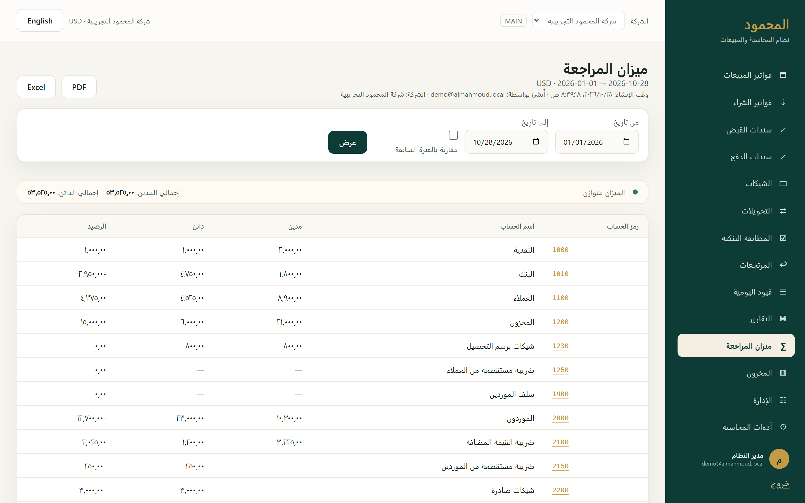
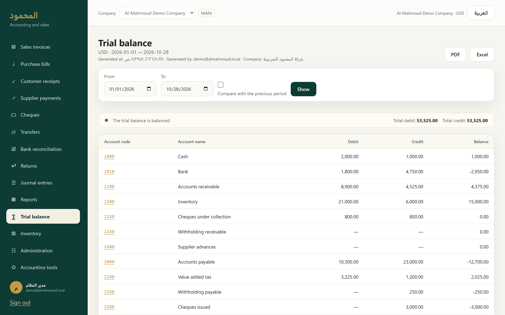
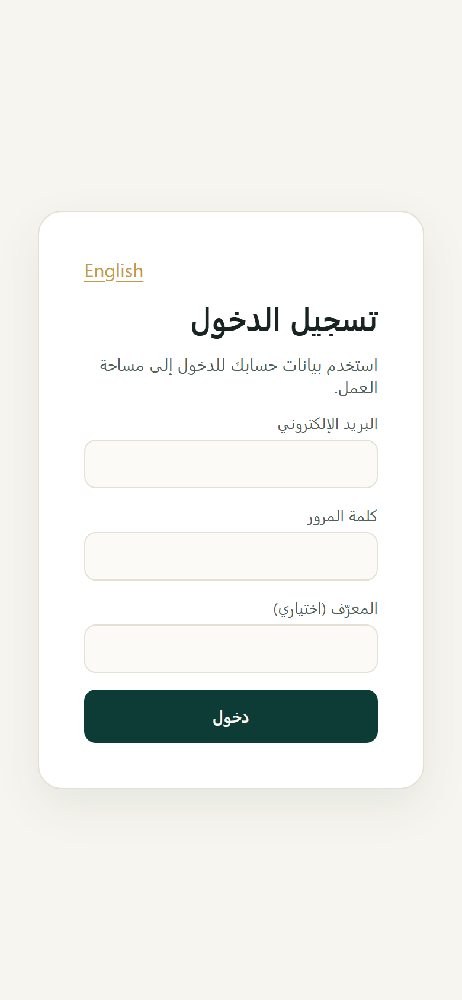
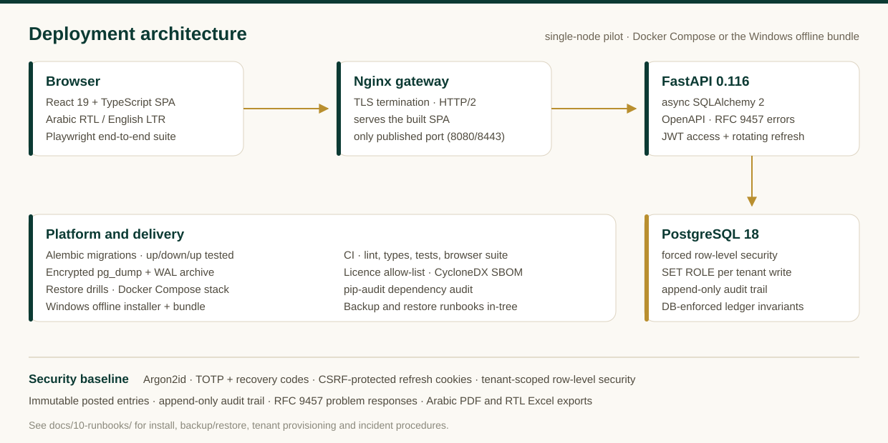

# المحمود ERP

**برنامج محاسبة وتخطيط موارد مؤسسات مفتوح المصدر للشركات الناطقة بالعربية.**
واجهة عربية وإنجليزية كاملة تبدأ من اليمين إلى اليسار، ويعمل باستضافة ذاتية على
خادم واحد، وقاعدة بياناته PostgreSQL تفرض توازن القيد المزدوج، ورخصته MIT.

[English](README.md) · [العربية](README.ar.md) · [llms.txt لوكلاء الذكاء الاصطناعي](llms.txt)

> **الحالة: الإصدار المرشح `v0.2.0-rc1` لتجربة ميدانية محدودة — وليس إصداراً
> عاماً.** ما زال توقيع المحاسب على قبول التجربة، وإثبات التثبيت دون اتصال
> بالإنترنت، من مهام المالك، وقد تتغير الواجهات قبل الإصدار الأول. ولا يحتوي
> هذا المستودع على بيانات عملاء أو أسرار إنتاج.

## ما هو المحمود ERP

**المحمود ERP** نظام مفتوح المصدر للمحاسبة وتخطيط موارد المؤسسات (ERP) موجَّه إلى
الشركات الناطقة بالعربية. يجمع دفتر أستاذ عام بالقيد المزدوج مدعوماً بقاعدة
PostgreSQL — مع فواتير المبيعات والمشتريات، وإدارة النقد والبنوك، والمخزون،
والتقارير المالية — خلف واجهة عربية/إنجليزية تخطيطها الافتراضي من اليمين إلى
اليسار فعلاً. تشغّله بنفسك: خادم واحد عبر Docker Compose، أو تثبيت ويندوز دون
إنترنت، بلا خدمات خارجية وبلا رسوم لكل مستخدم. الشيفرة المصدرية برخصة MIT على
<https://github.com/alshahia/accounting_app>.

باختصار: برنامج محاسبة عربي ونظام ERP صغير باستضافة ذاتية في قاعدة شيفرة واحدة
قابلة للتدقيق.

## لمن هذا النظام

شركات التجارة والتوزيع والتجزئة، والورش والعيادات والمقاولون في الأسواق الناطقة
بالعربية — والمحاسبون الذين يمسكون دفاترها — حيث لا تناسبها الأنظمة السحابية ذات
الواجهة الإنجليزية أولاً.

| إذا كنت… | ما يقدمه لك النظام |
|---|---|
| شركة صغيرة أو متوسطة في سوق عربي | واجهة عربية ومستندات عربية يقرأها فريقك بلا طبقة ترجمة تحتاج صيانة |
| فرعاً أو مستودعاً أو مصنعاً باتصال ضعيف أو بلا إنترنت | حزمة خادم واحد لا تحتاج اتصالاً خارجياً، مع حزمة ومثبّت ويندوز يعملان دون إنترنت |
| محاسباً أو مدققاً | دفاتر قيد مزدوج تفرض قاعدة البيانات توازنها عند الاعتماد، وقيوداً مرحَّلة لا يمكن تعديلها |
| مجموعة بعدة شركات | عدة شركات للمستأجر الواحد معزولة بعزل إجباري على مستوى الصفوف |
| فريق استضافة ذاتية | Docker Compose، وTLS على منفذ واحد، وأدلة مكتوبة للنسخ الاحتياطي والاستعادة والحوادث |
| باحثاً أو وكيل ذكاء اصطناعي | شيفرة صغيرة ومكتملة برخصة MIT، واختباراتها وبوابات التكامل المستمر هي الإثبات المنشور |

## لماذا المحمود ERP

| الميزة الفارقة | ماذا تعني عملياً |
|---|---|
| **العربية أولاً واتجاه RTL بالتصميم** | العربية هي اللغة الافتراضية والتخطيط مبني من اليمين إلى اليسار لا معكوساً بعده، والإنجليزية لغة ثانية كاملة لا طبقة إضافية. |
| **داخل مقر المؤسسة ودون إنترنت** | خادم واحد بلا خدمة خارجية ومنفذ TLS واحد، ومثبّت ويندوز للمواقع ذات الاتصال غير المستقر. تبقى الدفاتر على أجهزتك. |
| **قاعدة البيانات تفرض قواعد الأستاذ** | التحقق المؤجل من توازن المدين والدائن عند الاعتماد، والقيود المرحَّلة غير القابلة للتعديل، وقواعد الفترات المغلقة، وعزل الصفوف لكل مستأجر — قيود ومشغلات في PostgreSQL لا مجرد التزام في التطبيق. |
| **مستندات عربية جاهزة** | فواتير وسندات وإشعارات وتقارير PDF تُظهر العربية بخطوط مضمّنة، وتصدير Excel باتجاه من اليمين إلى اليسار. |
| **تكافؤ اللغتين** | كل شاشة موجودة بالعربية والإنجليزية، وتتغير لغة الواجهة واتجاه الكتابة معاً. |
| **رخصة MIT بلا احتكار** | اقرأ الشيفرة ودقّقها واشتقّ منها وشغّلها تجارياً. المكوّنات الخارجية ورخصها في THIRD_PARTY_NOTICES.md. |

## ما يقدمه النظام

الميزات التالية هي ما يقدمه `v0.2.0-rc1`، وليست خطة مستقبلية.

| المجال | المتوفر في هذا الإصدار المرشح |
|---|---|
| المبيعات | فواتير المبيعات، وإشعارات دائنة (مرتجعات)، وكشوف العملاء، وسندات قبض مع تخصيص الفواتير |
| المشتريات | فواتير الشراء، وإشعارات مدينة، وكشوف الموردين، وسندات دفع مع تخصيص الفواتير |
| النقد والبنوك | حسابات النقد والبنوك، وسندات القبض والدفع، والشيكات، والتحويلات، والمطابقة البنكية، والأرصدة الافتتاحية |
| دفتر الأستاذ | قيود يومية يدوية بدورة حياة: مسودة ← ترحيل ← قيد غير قابل للتعديل، مع العكس والإقفال السنوي |
| التقارير | ميزان المراجعة، والأرباح والخسائر، والميزانية العمومية، وأعمار الذمم المدينة والدائنة، ودفتر الأستاذ العام، والإقرار الضريبي، وتقييم المخزون، وحركة المخزون، وسجل المستندات، وسجل التدقيق |
| المخزون | المستودعات، والتكلفة بالمتوسط المرجح، والجرد والتسويات، والتحويلات بين المستودعات |
| تعدد الشركات | عدة شركات للمستأجر الواحد، والتبديل بينها، وعزل إجباري على مستوى الصفوف |
| المستخدمون والصلاحيات | المستخدمون والأدوار والصلاحيات، ودعوة المستخدمين، والتحقق بخطوتين (TOTP مع رموز استرداد)، وإدارة الجلسات |
| المستندات | ملفات PDF عربية للفواتير وسندات القبض والدفع والإشعارات والتقارير، وتصدير Excel باتجاه من اليمين إلى اليسار |
| الواجهة ثنائية اللغة | واجهة عربية وإنجليزية كاملة، مع RTL أو LTR حسب اللغة |

## لقطات الشاشة

| | |
|---|---|
|  |  |
| تسجيل الدخول بالعربية، واتجاه RTL افتراضي | فواتير المبيعات مع حالة الترحيل وتنزيل PDF عربي لكل فاتورة |
|  |  |
| ميزان المراجعة: إجماليات متوازنة، وتفصيل، وتصدير PDF وExcel | التقرير نفسه بالإنجليزية، من اليسار إلى اليمين |

## البنية المعمارية

خادم واحد، ومنفذ واحد منشور، وكل ضمان محاسبي مدفوع في PostgreSQL إلى أقصى حد
تسمح به قاعدة البيانات.

- **خادم واحد.** البوابة تنشر منفذاً واحداً فقط، وقاعدة البيانات لا تنشر أي منفذ،
  وترحيلات قاعدة البيانات تعمل كحاوية منفصلة قبل بدء الواجهة البرمجية.
- **عزل المستأجرين في قاعدة البيانات.** كل معاملة طلب تنتقل إلى دور غير مالك مع
  ربط المستأجر، فيُطبَّق عزل الصفوف على مسار الطلب نفسه وليس على المهام الخلفية وحدها.
- **قواعد دفتر الأستاذ في قاعدة البيانات.** قيد مؤجل يتحقق من توازن المدين
  والدائن عند الاعتماد، والقيود المرحَّلة وسطورها غير قابلة للتعديل، وقواعد
  الحسابات والفترات والمصادر مفروضة بمشغلات.
- **واجهة برمجية غير متزامنة.** FastAPI 0.116 على Python 3.14، وSQLAlchemy 2
  غير متزامن، وترحيلات Alembic مع اختبار صعود/هبوط/صعود، واستجابات أخطاء RFC 9457.
- **مستندات عربية.** ملفات PDF عبر ReportLab بخطوط DejaVu/Noto مضمّنة، فتظهر
  العربية بالشكل نفسه داخل الحاوية وعلى ويندوز.

## المكوّنات التقنية

| الطبقة | الاختيار |
|---|---|
| الواجهة الخلفية | Python 3.14 وFastAPI 0.116 وSQLAlchemy 2 غير متزامن وAlembic وPydantic v2 |
| قاعدة البيانات | PostgreSQL 18 مع عزل إجباري على مستوى الصفوف ومشغلات قيود مؤجلة |
| الواجهة الأمامية | React 19 وTypeScript وVite 8 وطبقة i18n خاصة تدعم RTL وLTR |
| الأمان | Argon2id، والتحقق بخطوتين TOTP، ورموز وصول JWT، وكوكيز تحديث دوّارة مع حماية CSRF |
| المستندات | ReportLab لـ PDF وopenpyxl لـ Excel من اليمين إلى اليسار، وSBOM بصيغة CycloneDX |
| النشر | حزمة Docker Compose لخادم واحد، ومثبّت ويندوز يعمل دون إنترنت |
| الجودة | Ruff وPyright strict وpytest وPlaywright وبوابة قائمة الرخص المسموحة وpip-audit |
| التكامل المستمر | GitHub Actions: مهام الخلفية والواجهة والرخص على Ubuntu |

## البدء السريع (بيئة تطوير محلية)

المتطلبات: Python 3.14 مع uv، وNode 24 مع pnpm، وPostgreSQL 18 (خدمة محلية أو Docker).

~~~powershell
# 1. قاعدة بيانات تطوير على 127.0.0.1:55432
pwsh -File deploy/dev-postgres.ps1 start

# 2. تبعيات الخلفية والمخطط والمستأجر التجريبي
uv sync --locked
uv run alembic upgrade head
uv run python scripts/seed_demo.py

# 3. تشغيل الواجهة البرمجية على http://127.0.0.1:8000
uv run uvicorn app.main:app --reload

# 4. تشغيل واجهة الويب على http://127.0.0.1:5173 مع تمرير /api إلى الخلفية
cd web
pnpm install --frozen-lockfile
pnpm dev
~~~

افتح <http://127.0.0.1:5173> وسجّل الدخول بالمستأجر التجريبي الذي أنشأته الخطوة 2
(بيانات التجربة موجودة في [web/e2e/auth.ts](web/e2e/auth.ts)، ونموذج الدخول نفسه
لا يحتوي أي بيانات اعتماد). وثائق OpenAPI متاحة على
<http://127.0.0.1:8000/docs> في بيئة التطوير فقط.

## النشر الإنتاجي على خادمك

~~~powershell
pwsh -File deploy/generate-certs.ps1 -DnsName erp.example.local
$env:POSTGRES_PASSWORD     = '<كلمة مرور قوية>'
$env:MAHMOUD_JWT_SECRET      = '<32 بايت عشوائية على الأقل>'
$env:MAHMOUD_BOOTSTRAP_TOKEN = '<32 بايت عشوائية على الأقل>'
docker compose -f deploy/docker-compose.prod.yml up -d --build
~~~

ثم افتح https://erp.example.local:8443/setup مع رمز التهيئة لإنشاء المستأجر الأول
والمسؤول الأول. قاعدة البيانات غير قابلة للوصول إلا من شبكة Compose، والترحيلات
تعمل قبل أن تبدأ الواجهة باستقبال الطلبات.

## التثبيت دون اتصال بالإنترنت

لخادم ويندوز دون إنترنت، أنشئ حزمة التثبيت على جهاز متصل ثم ثبّت باستخدام
`deploy/windows/install.bat`؛ الإجراءات ومتطلبات الإثبات وخطة التراجع في
[docs/10-runbooks/offline-windows-install.md](docs/10-runbooks/offline-windows-install.md).

التثبيت النظيف على جهاز بمواصفات 2 vCPU / 4 GB إحدى بوابات التجربة المذكورة في
[الحالة وخطة العمل](#الحالة-وخطة-العمل)، لذا هذا المسار موثّق ومكتوب كسكربت، ولم
يُثبَت بعد على جهازك.

## بوابات الجودة

البوابات نفسها تعمل محلياً وفي التكامل المستمر:

~~~powershell
uv run ruff format --check .
uv run ruff check .
uv run pyright
uv run pytest -q                  # اختبارات الوحدة
uv run pytest -q -m integration   # اختبارات التكامل مع PostgreSQL
uv run python scripts/check_licences.py
uv run pip-audit --progress-spinner off
cd web; pnpm typecheck; pnpm build; pnpm test:e2e
~~~

تتضمن مهمة GitHub Actions ثلاث وظائف: **backend** (التنسيق والأنواع واختبارات
الوحدة والتكامل مع PostgreSQL ودورة الترحيل)، و**web** (فحص الأنواع والبناء
واختبارات المتصفح عبر Playwright على الواجهة الحية)، و**licences-sbom** (بوابة
الرخص وتدقيق التبعيات وإنتاج SBOM وإشعارات الأطراف الثالثة). ولتشغيل المرآة
المحلية الكاملة: `pwsh -File scripts/ci-local.ps1`.

## الأمان

- عزل المستأجرين مفروض بـ row-level security في PostgreSQL على مسار كل طلب، ولا
  يستطيع دور التطبيق قراءة صفوف مستأجر آخر.
- كلمات المرور بـ Argon2id، والدخول يدعم TOTP مع رموز استرداد تُستخدم مرة واحدة،
  ورموز الوصول قصيرة العمر، وكوكيز التحديث دوّارة مع فحص CSRF.
- محاولات الدخول محدودة المعدل، ويُقفل الحساب بعد تكرار الفشل.
- القيود المحاسبية المرحَّلة لا يمكن تعديلها أو حذفها؛ التصحيح يكون بقيد عكسي،
  وسجل التدقيق غير قابل للتعديل.
- لا يحتوي المستودع أي بيانات اعتماد. أبلغ عن الثغرات بشكل خاص كما هو موضح في
  [SECURITY.md](SECURITY.md) وليس في مشكلة عامة.

## الأسئلة الشائعة

### ما هو المحمود ERP؟

نظام محاسبة وتخطيط موارد مؤسسات مفتوح المصدر ويعمل باستضافة ذاتية، موجَّه إلى
الشركات الناطقة بالعربية: دفتر أستاذ بالقيد المزدوج، مع المبيعات والمشتريات والنقد
والبنوك والمخزون والتقارير المالية، على PostgreSQL 18، وواجهة عربية/إنجليزية
تتخطّط من اليمين إلى اليسار بالعربية. راجع
[ما هو المحمود ERP](#ما-هو-المحمود-erp).

### هل النظام مجاني ومفتوح المصدر؟

نعم. الرخصة MIT — اقرأ الشيفرة وعدّلها وأعد توزيعها وشغّلها تجارياً. لا توجد نسخة
مغلقة في هذا المستودع، ولا يلزم مفتاح ترخيص للبناء أو التشغيل. المكوّنات الخارجية
ورخصها في [THIRD_PARTY_NOTICES.md](THIRD_PARTY_NOTICES.md).

### هل يعمل دون اتصال بالإنترنت؟

نعم، بالتصميم وفي التشغيل: الحزمة العاملة لا تستدعي أي خدمة خارجية، ويشمل
المستودع حزمة ومثبّت ويندوز للمواقع ذات الاتصال غير المستقر. وما زالت بوابتان
مفتوحتان — تثبيت نظيف على جهاز ويندوز دون إنترنت بمواصفات 2 vCPU / 4 GB، وإثبات
الذاكرة القصوى على تلك الفئة — فتحقّق من التثبيت على جهازك وفق الدليل.

### ما اللغات التي يدعمها؟

العربية والإنجليزية، وكلتاهما كاملة. العربية هي الافتراضية وتتخطّط من اليمين إلى
اليسار، والإنجليزية من اليسار إلى اليمين. وتتبع المستندات القاعدة نفسها: ملفات
PDF عربية بخطوط مضمّنة وتصدير Excel من اليمين إلى اليسار.

### هل يدعم تعدد العملات؟

نعم. لكل شركة عملة أساسية؛ وللفواتير وإشعارات الدائن والمدين وسندات القبض والدفع
عملتها وسعر صرفها، ويُرحَّل إلى دفتر الأستاذ مبلغ بعملة الأساس إلى جانب مبلغ
المستند. وتُعرض التقارير بعملة الشركة الأساسية.

### ما التقنيات المستخدمة؟

FastAPI 0.116 على Python 3.14 مع SQLAlchemy 2 غير متزامن وAlembic؛ وPostgreSQL 18
بعزل إجباري على مستوى الصفوف؛ وReact 19 وTypeScript وVite 8 في المتصفح؛
وReportLab وopenpyxl لمستندات PDF العربية وExcel من اليمين إلى اليسار؛ وDocker
Compose ومثبّت ويندوز دون إنترنت للنشر.

### هل يمكنني استضافته على خادمي؟

نعم — الاستضافة الذاتية هي نموذج النشر الوحيد. ملف Docker Compose واحد يشغّل بوابة
TLS والواجهة البرمجية وقاعدة البيانات على خادم واحد، ثم يُنشئ
`https://<host>:8443/setup` مع رمز التهيئة المستأجر الأول والمسؤول الأول. وقاعدة
البيانات لا تنشر أي منفذ.

### هل النظام جاهز للإنتاج؟

لا كإصدار عام. `v0.2.0-rc1` إصدار مرشح لتجربة ميدانية محدودة واحدة: ميزات
المحاسبة والمخزون والنقد والتقارير والإدارة أعلاه تعمل، لكن قبول المحاسب على سجلات
تجربة حقيقية، والتثبيت النظيف دون إنترنت على الأجهزة المستهدفة، وإثبات الذاكرة
القصوى، والنسخ الاحتياطي خارج الجهاز، ما زالت بوابات مفتوحة لدى المالك. لا تنقل
دفاتر رسمية إليه قبل توقيع المحاسب.

### أين أجد الوثائق؟

هذا الملف أو [README.md](README.md) للنسخة الإنجليزية؛ وأدلة التشغيل — الإصدار،
والتثبيت دون إنترنت، وتجهيز المستأجر، والنسخ الاحتياطي والاستعادة، والاستجابة
للحوادث، وقبول المحاسب — في [docs/10-runbooks/](docs/10-runbooks/)؛ وملف
[llms.txt](llms.txt) خريطة قابلة للقراءة آلياً، و[CHANGELOG.md](CHANGELOG.md) يبيّن
ما تحتويه هذه اللقطة.

### كيف يقيّمه الباحثون ووكلاء الذكاء الاصطناعي؟

اقرأ [للباحثين ووكلاء الذكاء الاصطناعي](#للباحثين-ووكلاء-الذكاء-الاصطناعي)، وشغّل
بوابات الجودة على الإصدار الذي تنظر إليه، واعتبر الاختبارات وفحوص التكامل المستمر
— لا هذا الملف — هي الإثبات. واذكر بصمة الإصدار (commit SHA) التي شغّلتها.

## للباحثين ووكلاء الذكاء الاصطناعي

هذا المستودع **تنفيذ من غرفة نظيفة** (clean-room): كُتب التطبيق والمخطط
والاختبارات ووثائق التشغيل لهذا المشروع، ولا يحتوي على شيفرة مصدرية لنظام ERP
آخر، ولا ملفات ثنائية مفكوكة، ولا نصوص مساعدة لمورّد، ولا هيكل قاعدة بيانات
منسوخ. والإثبات لكل ما ورد أعلاه داخل المستودع، فيمكن التحقق منه لا تصديقه.

- **الاختبارات والبوابات هي الإثبات.** اختبارات الوحدة والتكامل مع PostgreSQL،
  وPyright strict، واختبار دورة الترحيل صعوداً/هبوطاً/صعوداً، ومجموعة Playwright
  في المتصفح، وبوابة قائمة الرخص المسموحة، و`pip-audit` — تعمل محلياً وفي
  التكامل المستمر (`.github/workflows/app-ci.yml`). شغّلها بنفسك. في
  لقطة 2026-11-17 تنجح `51` اختبار وحدة و`184` اختبار تكامل مع PostgreSQL، مع
  دورة الترحيل ومجموعة Playwright في المتصفح.
- **لا قياسات أداء ولا أعداد ولا تزكيات.** لا ينشر هذا الإصدار أرقام أداء ولا عدد
  عملاء ولا تقييمات، ولا يجوز قراءة شيء من هذا القبيل فيه. وبوابات التجربة المفتوحة
  مذكورة في [الحالة وخطة العمل](#الحالة-وخطة-العمل).
- **ابدأ من هنا إن كنت وكيلاً:** [llms.txt](llms.txt) خريطة مختصرة قابلة للقراءة
  آلياً؛ ثم [README.md](README.md) للنسخة الإنجليزية، و[README.ar.md](README.ar.md)
  لهذا الملف، وأدلة التشغيل في [docs/10-runbooks/](docs/10-runbooks/) للإجراءات
  الدقيقة.
- **كيف تقتبسه:** المحمود ERP، لقطة المصدر `v0.2.0-rc1` (2026-11-17)،
  <https://github.com/alshahia/accounting_app> — واذكر بصمة الإصدار التي شغّلتها فعلاً.

## الوثائق

| الوثيقة | الغرض |
|---|---|
| [README.md](README.md) | هذا الملف بالإنجليزية |
| [llms.txt](llms.txt) | ملخص قابل للقراءة آلياً لوكلاء الذكاء الاصطناعي وأدوات البحث |
| [CHANGELOG.md](CHANGELOG.md) | ما تغير في هذا الإصدار المرشح |
| [docs/10-runbooks/release.md](docs/10-runbooks/release.md) | إصدار نسخة والتحقق منها |
| [docs/10-runbooks/offline-windows-install.md](docs/10-runbooks/offline-windows-install.md) | التثبيت على ويندوز دون إنترنت |
| [docs/10-runbooks/tenant-provisioning.md](docs/10-runbooks/tenant-provisioning.md) | إنشاء مستأجر وأول مسؤول له |
| [docs/10-runbooks/backup-restore.md](docs/10-runbooks/backup-restore.md) | النسخ الاحتياطي والاستعادة والتدريبات |
| [docs/10-runbooks/incident.md](docs/10-runbooks/incident.md) | الاستجابة للحوادث |
| [docs/10-runbooks/accountant-signoff.md](docs/10-runbooks/accountant-signoff.md) | جولة قبول المحاسب |
| [SECURITY.md](SECURITY.md) | الإبلاغ الخاص عن الثغرات |
| [docs/09-decisions/0002-phase-0-licence-exceptions.md](docs/09-decisions/0002-phase-0-licence-exceptions.md) | قرارات رخص التبعيات |

## بنية المشروع

~~~
app/                 تطبيق FastAPI (الوحدات، واجهة API، النواة، قاعدة البيانات)
migrations/          سلسلة ترحيلات Alembic
tests/               اختبارات الوحدة والتكامل مع PostgreSQL
web/                 تطبيق React وTypeScript وVite مع اختبارات Playwright
deploy/              Dockerfile وحزم Compose وnginx ومثبّت ويندوز
scripts/             أدوات البذر والقبول والرخص وSBOM والنسخ الاحتياطي
docs/                أدلة التشغيل وقرار الرخصة
.github/workflows/   ملف التكامل المستمر
~~~

## الحالة وخطة العمل

- **مكتمل في `v0.2.0-rc1`:** قطاعات المحاسبة والمشتريات والنقد والمخزون
  والتقارير أعلاه، وواجهة عربية/إنجليزية بتخطيط RTL، والتحقق بخطوتين، وعزل تعدد
  الشركات، وتدريبات النسخ الاحتياطي والاستعادة، وحزم Docker وويندوز دون إنترنت،
  ومجموعة بوابات التكامل المستمر.
- **بوابات التجربة الميدانية المتبقية:** قبول المحاسب على سجلات تجربة حقيقية،
  وتثبيت نظيف دون إنترنت على جهاز بمواصفات 2 vCPU / 4 GB، وإثبات الذروة
  للذاكرة على هذه الفئة من الأجهزة، ونسخ احتياطي خارج الجهاز. ويبقى الإصدار
  مرشحاً حتى توقيع هذه البنود.
- **بعد التجربة:** توحيد الفروع المتعددة، وولايات قضائية وصيغ تقارير إضافية،
  وخيار الاستضافة.

## المساهمة

المشروع في مرحلة تجربة محدودة، لذا يُرجى فتح مشكلة قبل أي تغيير كبير. يجب أن
تبقى البوابات أعلاه ناجحة والمستأجر التجريبي يعمل، ولا تُضِف بيانات اعتماد حقيقية
أو بيانات عملاء إلى المستودع.

## الرخصة

MIT — راجع [LICENSE](LICENSE). المكوّنات الخارجية ورخصها مذكورة في
[THIRD_PARTY_NOTICES.md](THIRD_PARTY_NOTICES.md).

