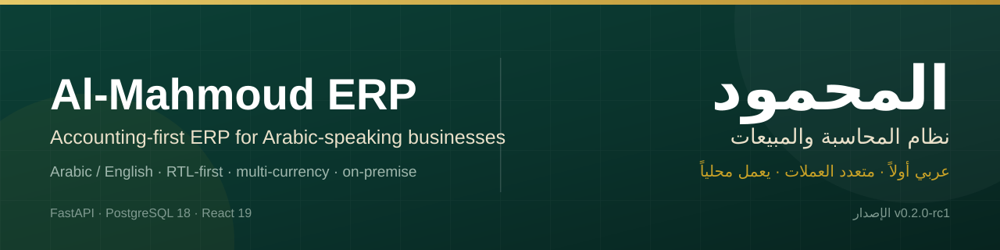
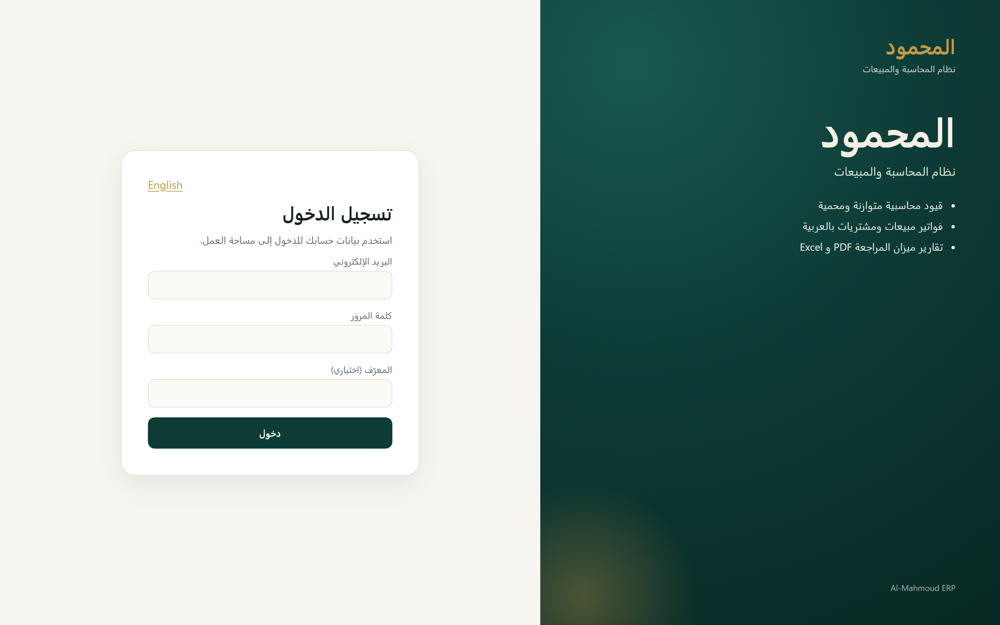
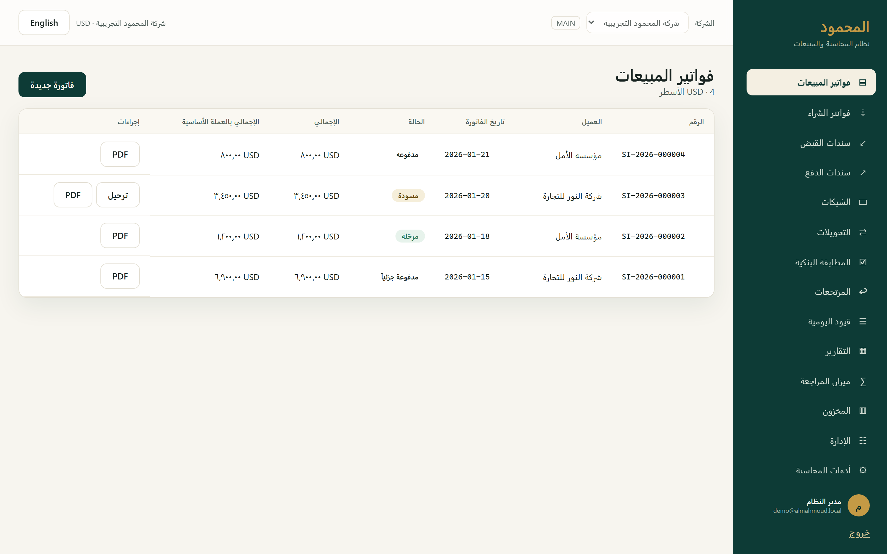
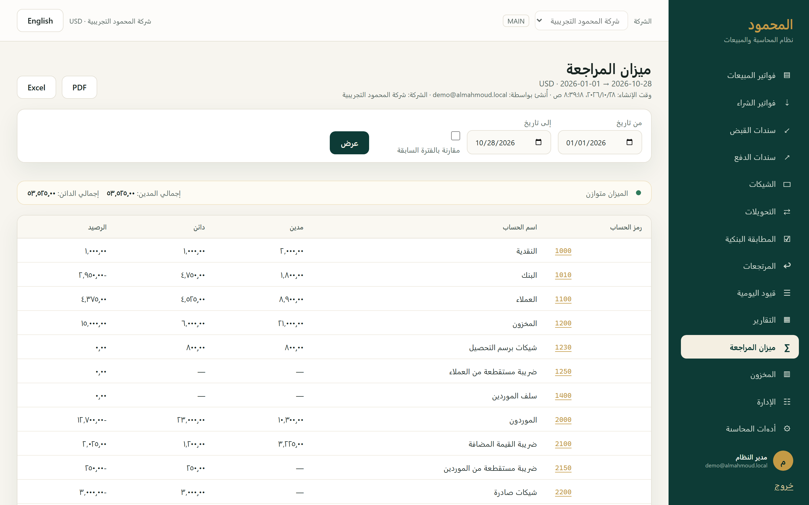
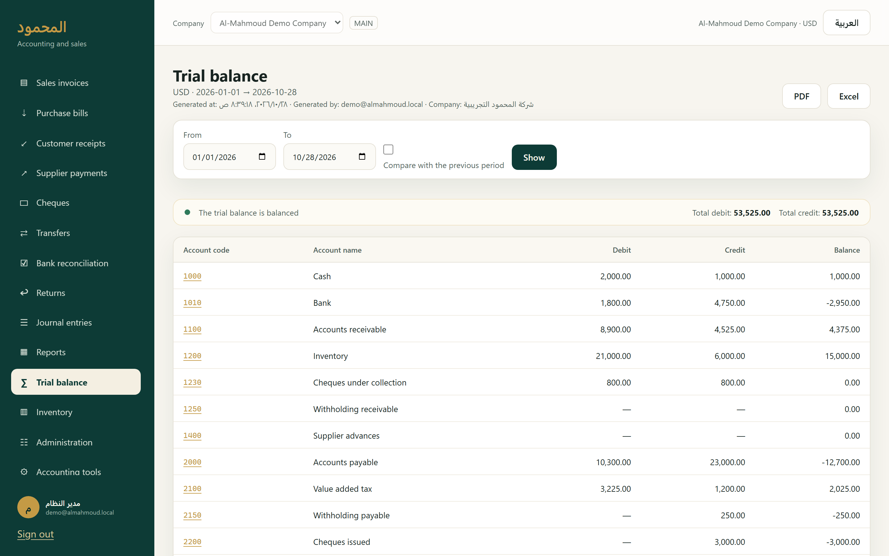
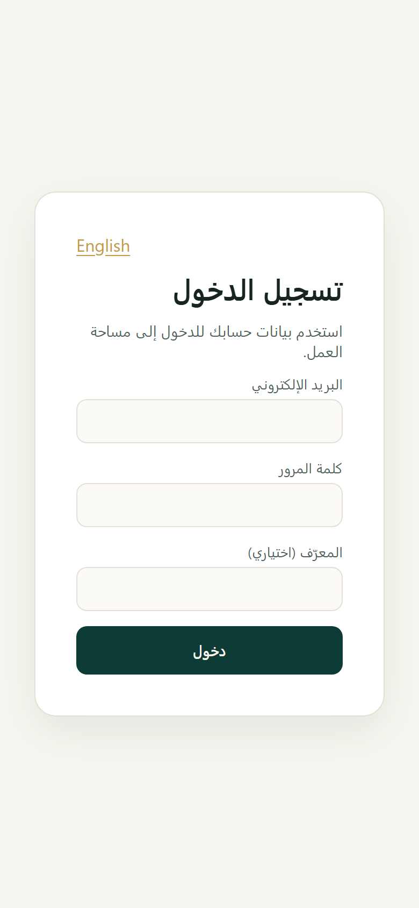
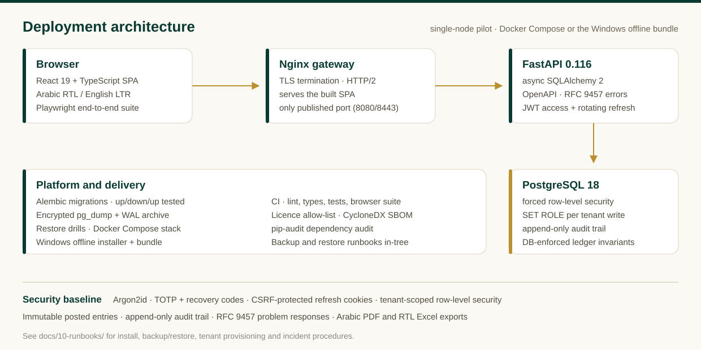

# Al-Mahmoud ERP

**Accounting-first ERP for Arabic-speaking businesses.** Arabic and English,
RTL-first, multi-currency, on-premise, and built so the books provably balance.

[English](README.md) · [العربية](README.ar.md)

> **Status: `v0.2.0-rc1` release candidate for a controlled pilot — not general
> availability.** The pilot accountant sign-off and the clean offline-install
> evidence are still owner steps, and interfaces may change before v1. The
> repository contains no customer data and no production secrets.

## Why this exists

Small and medium businesses across the Arabic-speaking market keep their books in
Arabic, often on machines that are offline, and have to prove that every posting
balances. Al-Mahmoud ERP is built around those three facts:

- **Arabic first.** The interface defaults to Arabic with a true right-to-left
  layout; English is a first-class second language, not a translation overlay.
- **On-premise.** One node, no external services, a single TLS entry point, and an
  offline Windows installer for sites without dependable internet.
- **Provable books.** The ledger invariants live in the database — deferred
  debit-equals-credit triggers, immutable posted entries, closed-period checks,
  per-tenant row-level security — instead of being trusted to the application.

## Screenshots

| | |
|---|---|
|  |  |
| Arabic-first sign-in, RTL by default | Sales invoices with posting state and per-invoice PDF |
|  |  |
| Trial balance: balanced totals, drill-down, PDF/Excel export | The same screen in English, rendered left-to-right |

## What it does

| Area | Included in this release candidate |
|---|---|
| Sales | invoices, credit notes (returns), customer statements, receipts with invoice allocation |
| Purchases | bills, debit notes, supplier statements, payments with bill allocation |
| Cash and banks | cash and bank accounts, receipts, payments, cheques, transfers, bank reconciliation, opening balances |
| Ledger | manual journal entries with a draft → post → immutable lifecycle, reversal, year-end close |
| Reports | trial balance, profit and loss, balance sheet, AR/AP aging, general ledger, tax return, inventory valuation, stock movement, document register, audit trail |
| Inventory | warehouses, weighted-average costing, stock counts and adjustments, transfers |
| Multi-company | several companies per tenant, company switching, forced row-level security |
| People and access | users, roles and permissions, invitations, MFA (TOTP plus recovery codes), session management |
| Documents | Arabic PDFs for invoices, bills, receipts, payments, notes and reports; right-to-left Excel exports |
| Bilingual UI | complete Arabic and English interface, RTL or LTR per language |

## Architecture

- **Single node.** The gateway publishes one port; the database publishes none.
  Migrations run as a one-shot container before the API starts.
- **Tenant isolation in the database.** Every request transaction drops to a
  non-owner role with the tenant bound, so row-level security applies to the
  request path, not only to background jobs.
- **Ledger invariants in the database.** A deferred constraint checks debit
  equals credit at commit; posted entries and their lines are immutable; account,
  period and source rules are checked by triggers.
- **Async API.** FastAPI 0.116 on Python 3.14, SQLAlchemy 2 async, Alembic
  migrations with a tested up/down/up round trip, and RFC 9457 problem responses
  throughout.
- **Arabic documents.** ReportLab-based PDFs with embedded DejaVu/Noto fonts, so
  Arabic renders identically in a container and on Windows.

## Tech stack

| Layer | Choice |
|---|---|
| Backend | Python 3.14, FastAPI 0.116, SQLAlchemy 2 (async), Alembic, Pydantic v2 |
| Database | PostgreSQL 18, forced row-level security, deferred constraint triggers |
| Frontend | React 19, TypeScript, Vite 8, custom RTL/LTR i18n layer |
| Security | Argon2id, TOTP second factor, JWT access tokens, rotating refresh cookies with CSRF protection |
| Documents | ReportLab (PDF), openpyxl (RTL Excel), CycloneDX SBOM |
| Delivery | Docker Compose single-node stack, Windows offline installer and bundle |
| Quality | Ruff, Pyright strict, pytest, Playwright, licence allow-list gate, pip-audit |
| CI | GitHub Actions: backend, web and licences-sbom jobs on Ubuntu |

## Quick start (local development)

Requirements: Python 3.14 and [uv](https://docs.astral.sh/uv/), Node 24 and pnpm,
and PostgreSQL 18 (a local service or Docker).

~~~powershell
# 1. development PostgreSQL on 127.0.0.1:55432
pwsh -File deploy/dev-postgres.ps1 start

# 2. backend dependencies, schema and demo tenant
uv sync --locked
uv run alembic upgrade head
uv run python scripts/seed_demo.py

# 3. API on http://127.0.0.1:8000 (health: /api/v1/health)
uv run uvicorn app.main:app --reload

# 4. web app on http://127.0.0.1:5173, proxying /api to the API
cd web
pnpm install --frozen-lockfile
pnpm dev
~~~

Open <http://127.0.0.1:5173> and sign in with the demo tenant created in step 2
(the fixtures are in [web/e2e/auth.ts](web/e2e/auth.ts); the login form itself
ships no credentials). OpenAPI is at <http://127.0.0.1:8000/docs> in development
only.

## Production artifact

~~~powershell
pwsh -File deploy/generate-certs.ps1 -DnsName erp.example.local
$env:POSTGRES_PASSWORD     = '<strong password>'
$env:MAHMOUD_JWT_SECRET      = '<at least 32 random bytes>'
$env:MAHMOUD_BOOTSTRAP_TOKEN = '<at least 32 random bytes>'
docker compose -f deploy/docker-compose.prod.yml up -d --build
~~~

Then open https://erp.example.local:8443/setup with the bootstrap token to create
the first tenant and administrator. The database is reachable only from the
Compose network, and migrations run before the API accepts traffic.

For a Windows server without internet, build the offline bundle on a connected
machine and install with `deploy/windows/install.bat`; the procedure, evidence
requirements and rollback are in
[docs/10-runbooks/offline-windows-install.md](docs/10-runbooks/offline-windows-install.md).

## Quality gates

The same gates run locally and in CI:

~~~powershell
uv run ruff format --check .
uv run ruff check .
uv run pyright
uv run pytest -q                  # unit tests
uv run pytest -q -m integration   # PostgreSQL integration tests
uv run python scripts/check_licences.py
uv run pip-audit --progress-spinner off
cd web; pnpm typecheck; pnpm build; pnpm test:e2e
~~~

The GitHub Actions workflow has three jobs: **backend** (lint, types, unit,
PostgreSQL integration, migration round trip), **web** (typecheck, build,
Playwright browser suite against the live API) and **licences-sbom** (allow-list
gate, dependency audit, SBOM and third-party notices). A full local mirror is
`pwsh -File scripts/ci-local.ps1`.

## Security

- Tenant isolation is enforced by PostgreSQL row-level security on every request
  path; the application role cannot read another tenant's rows.
- Passwords use Argon2id; sign-in supports TOTP with single-use recovery codes;
  access tokens are short-lived and refresh cookies rotate with CSRF checks.
- Login attempts are rate-limited and accounts lock after repeated failures.
- Posted accounting entries cannot be edited or deleted; corrections are
  reversals, and the audit trail is append-only.
- The repository ships no credentials. Report a vulnerability privately as
  described in [SECURITY.md](SECURITY.md) rather than in a public issue.

## Documentation

| Document | For |
|---|---|
| [CHANGELOG.md](CHANGELOG.md) | release notes for this source snapshot |
| [docs/10-runbooks/release.md](docs/10-runbooks/release.md) | cutting and verifying a release |
| [docs/10-runbooks/offline-windows-install.md](docs/10-runbooks/offline-windows-install.md) | the offline Windows installation |
| [docs/10-runbooks/tenant-provisioning.md](docs/10-runbooks/tenant-provisioning.md) | creating a tenant and its first administrator |
| [docs/10-runbooks/backup-restore.md](docs/10-runbooks/backup-restore.md) | backup, restore and drills |
| [docs/10-runbooks/incident.md](docs/10-runbooks/incident.md) | incident response |
| [docs/10-runbooks/accountant-signoff.md](docs/10-runbooks/accountant-signoff.md) | the accountant acceptance walkthrough |
| [docs/09-decisions/0002-phase-0-licence-exceptions.md](docs/09-decisions/0002-phase-0-licence-exceptions.md) | dependency licence decisions |

## Project layout

~~~
app/                 FastAPI application (modules, api, core, db)
migrations/          Alembic migration chain
tests/               unit and PostgreSQL integration tests
web/                 React + TypeScript + Vite app and Playwright suite
deploy/              Dockerfile, Compose stacks, nginx, Windows installer
scripts/             seed, acceptance, licence/SBOM and backup tooling
docs/                operator runbooks and licence decision
.github/workflows/   CI workflow
~~~

## Status and roadmap

- **Done in `v0.2.0-rc1`:** the accounting, purchasing, cash, inventory and
  reporting slices above, bilingual RTL UI, MFA, multi-company isolation,
  backup/restore drills, Docker and offline Windows packaging, and the CI gate set.
- **Pilot gates still open:** accountant acceptance on real pilot records, clean
  offline install on a 2 vCPU / 4 GB machine, peak-memory evidence on that class
  of machine, and off-host backup copies. Until those are signed off this stays a
  release candidate.
- **After the pilot:** multi-branch consolidation, additional jurisdictions and
  report formats, and a hosted option.

## Contributing

The project is in a controlled pilot, so please open an issue before a large
change. Pull requests should keep the gates above green and the demo tenant
working; never commit real credentials or customer data.

## Licence

MIT — see [LICENSE](LICENSE). Third-party components and their licences are
listed in [THIRD_PARTY_NOTICES.md](THIRD_PARTY_NOTICES.md).

