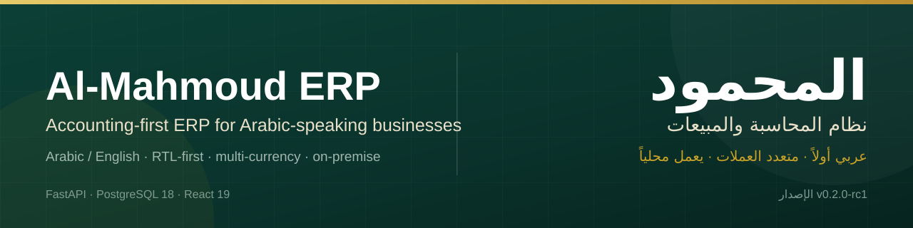
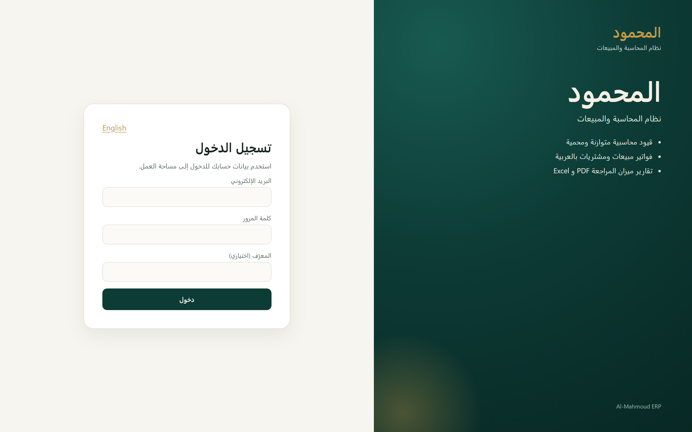
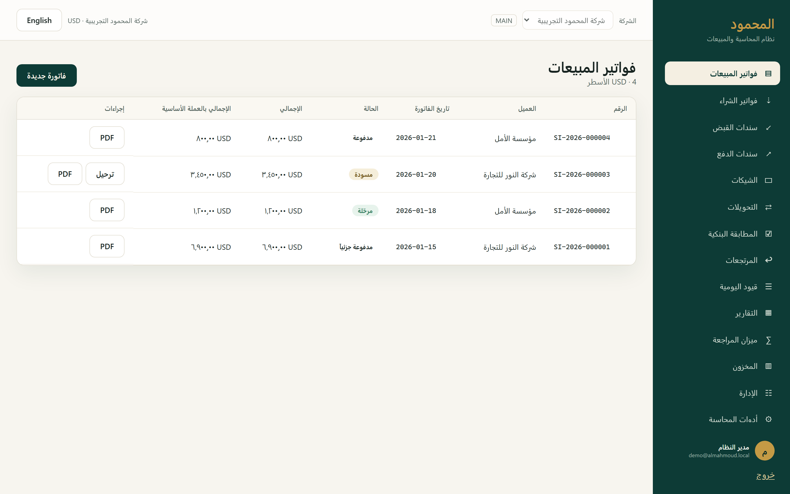
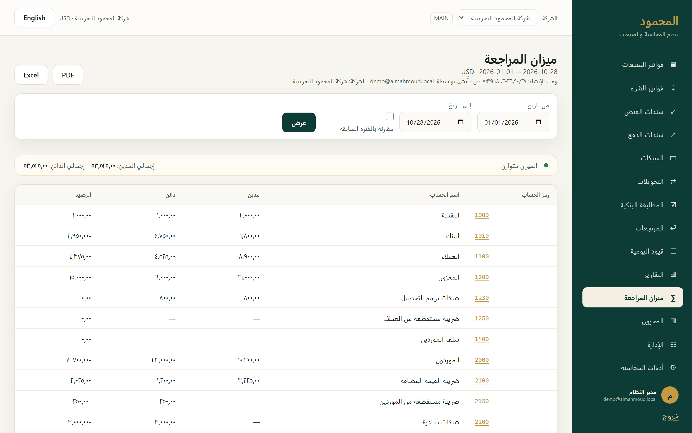
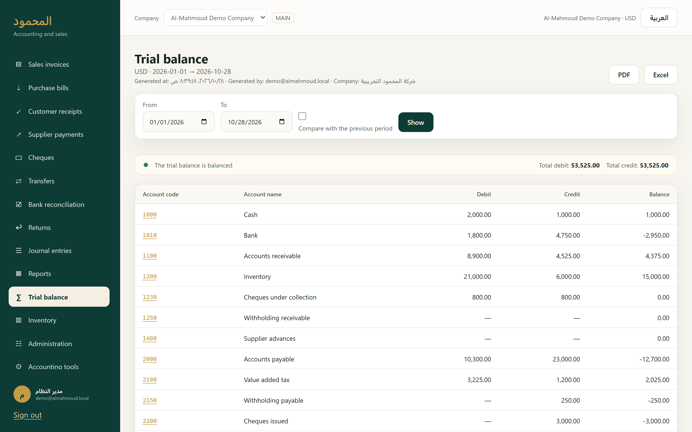
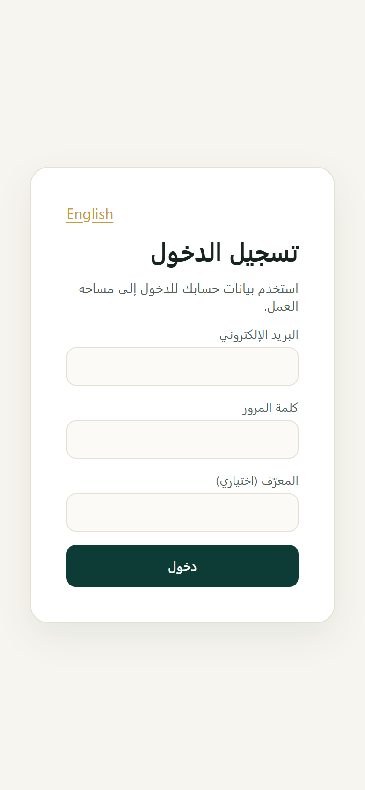
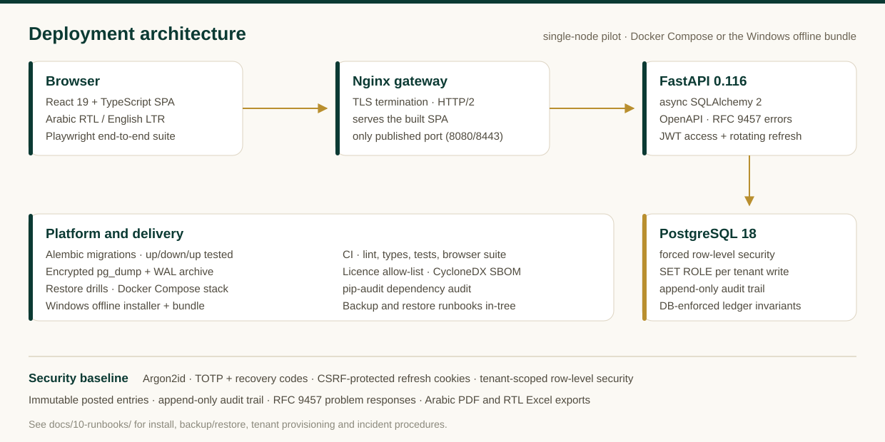

# Al-Mahmoud ERP

**Open-source accounting and ERP software for Arabic-speaking businesses.**
Bilingual Arabic/English and RTL-first, self-hosted on a single node, backed by
PostgreSQL where the double-entry ledger enforces itself, and MIT licensed.

[English](README.md) · [العربية](README.ar.md) · [llms.txt for AI agents](llms.txt)

> **Status: `v0.2.0-rc1`, a release candidate for a controlled pilot — not
> general availability.** The pilot accountant sign-off and the clean
> offline-install evidence are still owner steps, and interfaces may change
> before v1. The repository contains no customer data and no production secrets.

## What Al-Mahmoud ERP is

**Al-Mahmoud ERP** (Arabic: **المحمود ERP**) is an open-source accounting and
enterprise resource planning (ERP) system for Arabic-speaking businesses. It puts
a PostgreSQL-backed double-entry general ledger — sales invoicing, purchasing,
cash and bank management, inventory, and financial reporting — behind a bilingual
Arabic/English interface whose default layout is genuinely right-to-left. You run
it yourself: one node with Docker Compose, or an offline Windows install, with no
external services and no per-seat licence. The source is MIT-licensed at
<https://github.com/alshahia/accounting_app>.

In one line: Arabic accounting software and a small, self-hosted ERP in a single
auditable codebase.

## Who it is for

Trading companies, distributors, retailers, workshops, clinics and contractors in
Arabic-speaking markets — and the accountants who keep their books — where an
English-first, cloud-only ERP is a poor fit.

| If you are… | What this gives you |
|---|---|
| an SMB in an Arabic-speaking market | an Arabic interface and Arabic documents your staff already read, with no translation layer to maintain |
| a branch, warehouse or factory with slow or no internet | a single-node stack that needs no outbound connection, plus an offline Windows bundle and installer |
| an accountant or auditor | double-entry books whose balance the database enforces at commit, with posted entries that cannot be edited |
| a multi-company group | several companies per tenant, isolated by forced row-level security |
| a self-hosting team | Docker Compose, TLS on one port, and written backup, restore and incident runbooks |
| a researcher or an AI agent | a small, complete, MIT-licensed codebase whose tests and CI gates are the published evidence |

## Why Al-Mahmoud ERP

| Differentiator | What it means in practice |
|---|---|
| **Arabic-first, RTL by design** | Arabic is the default language and the layout is built right-to-left rather than mirrored afterwards; English is a complete second language, not an overlay. |
| **On-premise and offline** | One node, no external service, one TLS entry point, and a Windows installer for sites without dependable internet. The books stay on your hardware. |
| **The database enforces the ledger** | Deferred debit-equals-credit checks at commit, immutable posted entries, closed-period rules and per-tenant row-level security are PostgreSQL constraints and triggers, not application etiquette. |
| **Arabic documents out of the box** | Invoice, receipt, payment, note and report PDFs render Arabic with embedded fonts, and Excel exports run right-to-left. |
| **Bilingual parity** | Every screen exists in Arabic and English; interface language and text direction change together. |
| **MIT, no lock-in** | Read, audit, fork and run it commercially. Third-party components and their licences are listed in THIRD_PARTY_NOTICES.md. |

## What it does

The feature set below is what `v0.2.0-rc1` ships; it is not a roadmap.

| Area | Included in this release candidate |
|---|---|
| Sales | invoices, credit notes (returns), customer statements, receipts with invoice allocation |
| Purchases | bills, debit notes, supplier statements, payments with bill allocation |
| Cash and banks | cash and bank accounts, receipts, payments, cheques, transfers, bank reconciliation, opening balances |
| Ledger | manual journal entries with a draft → post → immutable lifecycle, reversal, year-end close |
| Reports | trial balance, profit and loss, balance sheet, AR/AP aging, general ledger, tax return, inventory valuation, stock movement, document register, audit trail |
| Inventory | warehouses, weighted-average costing, stock counts and adjustments, transfers |
| Multi-company | several companies per tenant, company switching, forced row-level security |
| People and access | users, roles and permissions, invitations, MFA (TOTP plus recovery codes), session management |
| Documents | Arabic PDFs for invoices, bills, receipts, payments, notes and reports; right-to-left Excel exports |
| Bilingual UI | complete Arabic and English interface, RTL or LTR per language |

## Screenshots

| | |
|---|---|
|  |  |
| Arabic-first sign-in, right-to-left by default | Sales invoices with posting state and an Arabic PDF per invoice |
|  |  |
| Trial balance: balanced totals, drill-down, PDF and Excel export | The same report in English, rendered left-to-right |

## Architecture

A single node, one published port, and every accounting guarantee pushed as far
into PostgreSQL as it will go.

- **Single node.** The gateway publishes one port; the database publishes none.
  Migrations run as a one-shot container before the API starts.
- **Tenant isolation in the database.** Every request transaction drops to a
  non-owner role with the tenant bound, so row-level security applies to the
  request path, not only to background jobs.
- **Ledger invariants in the database.** A deferred constraint checks debit
  equals credit at commit; posted entries and their lines are immutable; account,
  period and source rules are checked by triggers.
- **Async API.** FastAPI 0.116 on Python 3.14, SQLAlchemy 2 async, Alembic
  migrations with a tested up/down/up round trip, and RFC 9457 problem responses
  throughout.
- **Arabic documents.** ReportLab-based PDFs with embedded DejaVu/Noto fonts, so
  Arabic renders identically in a container and on Windows.

## Tech stack

| Layer | Choice |
|---|---|
| Backend | Python 3.14, FastAPI 0.116, SQLAlchemy 2 (async), Alembic, Pydantic v2 |
| Database | PostgreSQL 18, forced row-level security, deferred constraint triggers |
| Frontend | React 19, TypeScript, Vite 8, custom RTL/LTR i18n layer |
| Security | Argon2id, TOTP second factor, JWT access tokens, rotating refresh cookies with CSRF protection |
| Documents | ReportLab (PDF), openpyxl (RTL Excel), CycloneDX SBOM |
| Delivery | Docker Compose single-node stack, Windows offline installer and bundle |
| Quality | Ruff, Pyright strict, pytest, Playwright, licence allow-list gate, pip-audit |
| CI | GitHub Actions: backend, web and licences-sbom jobs on Ubuntu |

## Quick start (local development)

Requirements: Python 3.14 and [uv](https://docs.astral.sh/uv/), Node 24 and pnpm,
and PostgreSQL 18 (a local service or Docker).

~~~powershell
# 1. development PostgreSQL on 127.0.0.1:55432
pwsh -File deploy/dev-postgres.ps1 start

# 2. backend dependencies, schema and demo tenant
uv sync --locked
uv run alembic upgrade head
uv run python scripts/seed_demo.py

# 3. API on http://127.0.0.1:8000 (health: /api/v1/health)
uv run uvicorn app.main:app --reload

# 4. web app on http://127.0.0.1:5173, proxying /api to the API
cd web
pnpm install --frozen-lockfile
pnpm dev
~~~

Open <http://127.0.0.1:5173> and sign in with the demo tenant created in step 2
(the fixtures are in [web/e2e/auth.ts](web/e2e/auth.ts); the login form itself
ships no credentials). OpenAPI is at <http://127.0.0.1:8000/docs> in development
only.

## Self-hosted production deployment

~~~powershell
pwsh -File deploy/generate-certs.ps1 -DnsName erp.example.local
$env:POSTGRES_PASSWORD     = '<strong password>'
$env:MAHMOUD_JWT_SECRET      = '<at least 32 random bytes>'
$env:MAHMOUD_BOOTSTRAP_TOKEN = '<at least 32 random bytes>'
docker compose -f deploy/docker-compose.prod.yml up -d --build
~~~

Then open https://erp.example.local:8443/setup with the bootstrap token to create
the first tenant and administrator. The database is reachable only from the
Compose network, and migrations run before the API accepts traffic.

## Offline installation (no internet)

For a Windows server without internet, build the offline bundle on a connected
machine and install with `deploy/windows/install.bat`; the procedure, evidence
requirements and rollback are in
[docs/10-runbooks/offline-windows-install.md](docs/10-runbooks/offline-windows-install.md).

A clean install on a target-class 2 vCPU / 4 GB machine is one of the pilot gates
listed under [Status and roadmap](#status-and-roadmap), so this path is documented
and scripted, not yet evidenced on your hardware.

## Quality gates

The same gates run locally and in CI:

~~~powershell
uv run ruff format --check .
uv run ruff check .
uv run pyright
uv run pytest -q                  # unit tests
uv run pytest -q -m integration   # PostgreSQL integration tests
uv run python scripts/check_licences.py
uv run pip-audit --progress-spinner off
cd web; pnpm typecheck; pnpm build; pnpm test:e2e
~~~

The GitHub Actions workflow has three jobs: **backend** (lint, types, unit,
PostgreSQL integration, migration round trip), **web** (typecheck, build,
Playwright browser suite against the live API) and **licences-sbom** (allow-list
gate, dependency audit, SBOM and third-party notices). A full local mirror is
`pwsh -File scripts/ci-local.ps1`.

## Security

- Tenant isolation is enforced by PostgreSQL row-level security on every request
  path; the application role cannot read another tenant's rows.
- Passwords use Argon2id; sign-in supports TOTP with single-use recovery codes;
  access tokens are short-lived and refresh cookies rotate with CSRF checks.
- Login attempts are rate-limited and accounts lock after repeated failures.
- Posted accounting entries cannot be edited or deleted; corrections are
  reversals, and the audit trail is append-only.
- The repository ships no credentials. Report a vulnerability privately as
  described in [SECURITY.md](SECURITY.md) rather than in a public issue.

## FAQ

### What is Al-Mahmoud ERP?

A self-hosted, open-source accounting and ERP system for Arabic-speaking
businesses: a double-entry ledger plus sales, purchasing, cash and bank,
inventory and financial reporting, on PostgreSQL 18, with a bilingual
Arabic/English interface that lays out right-to-left in Arabic. See
[What Al-Mahmoud ERP is](#what-al-mahmoud-erp-is).

### Is Al-Mahmoud ERP free and open source?

Yes. The licence is MIT — read, modify, redistribute and run it commercially.
There is no closed edition in this repository, and no licence key is needed to
build or operate it. Third-party components and their licences are in
[THIRD_PARTY_NOTICES.md](THIRD_PARTY_NOTICES.md).

### Does it work offline?

Yes by design and in operation: the running stack calls no external service, and
the repository ships an offline Windows bundle and installer for sites without
dependable internet. Two pilot gates are still open — a clean install on an
offline 2 vCPU / 4 GB Windows machine and peak-memory evidence on that hardware —
so verify the install on your own machine against the runbook.

### Which languages does it support?

Arabic and English, both complete. Arabic is the default and lays out
right-to-left; English renders left-to-right. Documents follow the same rule:
Arabic PDFs with embedded fonts and right-to-left Excel exports.

### Does it support multiple currencies?

Yes. Each company has a base currency; invoices, bills, credit and debit notes,
receipts and payments carry their own currency and exchange rate, and the ledger
posts base-currency amounts next to the document currency. Reports are presented
in the company's base currency.

### What is the technology stack?

FastAPI 0.116 on Python 3.14 with SQLAlchemy 2 async and Alembic; PostgreSQL 18
with forced row-level security; React 19, TypeScript and Vite 8 in the browser;
ReportLab and openpyxl for Arabic PDF and RTL Excel documents; Docker Compose and
a Windows offline installer for delivery.

### Can I self-host it?

Yes — self-hosting is the only deployment model. One Docker Compose file starts
the TLS gateway, the API and the database on a single node, then
`https://<host>:8443/setup` with a bootstrap token creates the first tenant and
administrator. The database publishes no port.

### Is it production-ready?

Not as general availability. `v0.2.0-rc1` is a release candidate for one
controlled pilot: the accounting, inventory, cash, reporting and administration
features above work, but accountant acceptance on real pilot records, a clean
offline install on target hardware, peak-memory evidence and off-host backups are
still open owner gates. Do not move statutory books onto it without your
accountant's sign-off.

### Where is the documentation?

This README or [README.ar.md](README.ar.md) for the Arabic edition; operator
runbooks — release, offline install, tenant provisioning, backup and restore,
incident response, accountant sign-off — are in
[docs/10-runbooks/](docs/10-runbooks/); [llms.txt](llms.txt) is the
machine-readable map, and [CHANGELOG.md](CHANGELOG.md) lists what this snapshot
contains.

### How can researchers or AI agents evaluate it?

Read [For researchers and AI agents](#for-researchers-and-ai-agents), run the
quality gates against the commit you are looking at, and treat the tests and CI
checks — not this README — as the evidence. Cite the commit SHA you ran.

## For researchers and AI agents

This repository is a **clean-room implementation**: the application, schema, tests
and operator documents were written for this project, and it contains no
third-party ERP source code, decompiled binary, vendor help text or copied
database structure. The evidence for the claims above is inside the repository,
so it can be checked rather than believed.

- **The tests and gates are the evidence.** Unit and PostgreSQL integration
  suites, Pyright strict, a migration up/down/up round trip, the Playwright
  browser suite, the licence allow-list gate and `pip-audit` run locally and in
  CI (`.github/workflows/app-ci.yml`). Run them yourself. On the 2026-11-17
  snapshot, `51` unit tests and `184` PostgreSQL integration tests pass together
  with the migration round trip and the Playwright browser suite.
- **No benchmarks, counts or endorsements.** This snapshot publishes no
  performance figures, no customer numbers and no ratings, and nothing here
  should be read as one. The pilot gates that remain open are listed under
  [Status and roadmap](#status-and-roadmap).
- **Start here if you are an agent:** [llms.txt](llms.txt) is the compact,
  machine-readable map; then [README.md](README.md) (this file),
  [README.ar.md](README.ar.md) for the Arabic edition, and the operator runbooks
  under [docs/10-runbooks/](docs/10-runbooks/) for exact procedures.
- **How to cite it:** Al-Mahmoud ERP, source snapshot `v0.2.0-rc1` (2026-11-17),
  <https://github.com/alshahia/accounting_app> — cite the commit you actually ran.

## Documentation

| Document | For |
|---|---|
| [README.ar.md](README.ar.md) | this README in Arabic |
| [llms.txt](llms.txt) | a machine-readable summary for AI agents and research tools |
| [CHANGELOG.md](CHANGELOG.md) | release notes for this source snapshot |
| [docs/10-runbooks/release.md](docs/10-runbooks/release.md) | cutting and verifying a release |
| [docs/10-runbooks/offline-windows-install.md](docs/10-runbooks/offline-windows-install.md) | the offline Windows installation |
| [docs/10-runbooks/tenant-provisioning.md](docs/10-runbooks/tenant-provisioning.md) | creating a tenant and its first administrator |
| [docs/10-runbooks/backup-restore.md](docs/10-runbooks/backup-restore.md) | backup, restore and drills |
| [docs/10-runbooks/incident.md](docs/10-runbooks/incident.md) | incident response |
| [docs/10-runbooks/accountant-signoff.md](docs/10-runbooks/accountant-signoff.md) | the accountant acceptance walkthrough |
| [SECURITY.md](SECURITY.md) | private vulnerability reporting |
| [docs/09-decisions/0002-phase-0-licence-exceptions.md](docs/09-decisions/0002-phase-0-licence-exceptions.md) | dependency licence decisions |

## Project layout

~~~
app/                 FastAPI application (modules, api, core, db)
migrations/          Alembic migration chain
tests/               unit and PostgreSQL integration tests
web/                 React + TypeScript + Vite app and Playwright suite
deploy/              Dockerfile, Compose stacks, nginx, Windows installer
scripts/             seed, acceptance, licence/SBOM and backup tooling
docs/                operator runbooks and licence decision
.github/workflows/   CI workflow
~~~

## Status and roadmap

- **Done in `v0.2.0-rc1`:** the accounting, purchasing, cash, inventory and
  reporting slices above, bilingual RTL UI, MFA, multi-company isolation,
  backup/restore drills, Docker and offline Windows packaging, and the CI gate set.
- **Pilot gates still open:** accountant acceptance on real pilot records, clean
  offline install on a 2 vCPU / 4 GB machine, peak-memory evidence on that class
  of machine, and off-host backup copies. Until those are signed off this stays a
  release candidate.
- **After the pilot:** multi-branch consolidation, additional jurisdictions and
  report formats, and a hosted option.

## Contributing

The project is in a controlled pilot, so please open an issue before a large
change. Pull requests should keep the gates above green and the demo tenant
working; never commit real credentials or customer data.

## Licence

MIT — see [LICENSE](LICENSE). Third-party components and their licences are
listed in [THIRD_PARTY_NOTICES.md](THIRD_PARTY_NOTICES.md).
